# LAPORAN RESMI PENGUJIAN OTOMASI FITUR: SUBSIDI RUSH HOUR DRIVER
**EV-Moto & ECGO Ecosystem Automation Quality Assurance**

---

### RINGKASAN EKSEKUTIF (EXECUTIVE SUMMARY)

| Informasi Proyek | Detail Pelaksanaan |
| :--- | :--- |
| **Nama Fitur** | Subsidi Rush Hour Driver (Driver Rush Hour Subsidy Engine) |
| **Modul Terkait** | Web Admin Dashboard (`/rushHour/settings`, `/rushHour/history`) & Mobile Apps (Driver & User Pricing Engine) |
| **Lead QA Engineer** | Bhagus Arif Prayogo (Senior QA Engineer) |
| **Tanggal Pengujian** | 28 Oktober 2026 |
| **Target Lingkungan** | Staging / Dev (`https://evmotoadmin.justkidding.app`) |
| **Total Test Case Dieksekusi** | **108 Test Cases** (End-to-End & Full Regression) |
| **Hasil Pengujian** | **108 PASSED / 0 FAILED / 0 SKIPPED (100% Success Rate)** |
| **Durasi Eksekusi** | 187.74 detik |
| **Rekomendasi Deployment** | **READY FOR PRODUCTION RELEASE (GO)** |

---

## 1. LATAR BELAKANG & TUJUAN BISNIS
Fitur **Subsidi Rush Hour Driver** dikembangkan untuk memberikan insentif pendapatan tambahan (*income bonus*) secara otomatis kepada mitra pengemudi (Driver) pada periode jam sibuk (*rush hour*) yang telah dikonfigurasi melalui Web Admin Dashboard.

### Aturan Bisnis & Batasan (Business Rules & Scope):
1. **Dasar Kalkulasi Argo Original**:
   - Perhitungan subsidi secara ketat **hanya** didasarkan pada harga dasar perjalanan (*original base argo*).
   - Pengurangan voucher/diskon promo, penambahan biaya tunggu (*waiting fee*), denda pembatalan (*penalty*), maupun tip pengguna **sama sekali tidak mempengaruhi tier subsidi driver**.
2. **Seamless Driver Experience**:
   - Fitur bersifat transparan dan *seamless*. Driver tidak melihat *badge* atau perhitungan internal teknis yang membingungkan. Driver secara langsung menerima total pendapatan bersih yang telah ditambahkan bonus subsidi saat order diselesaikan.
3. **Pengaturan Fleksibel Melalui Admin Dashboard**:
   - Mendukung multi-window jam sibuk (contoh: Shift Pagi 06:45 - 08:45 WIB, Shift Sore 10:45 - 18:45 WIB).
   - Mendukung skema multi-tier argo (Tier 1: Argo $\le$ Rp 10.000 $\rightarrow$ Bonus Rp 3.000; Tier 2: Argo $\le$ Rp 20.000 $\rightarrow$ Bonus Rp 4.000; Tier 3: Argo $>$ Rp 20.000 / Tanpa Batas $\rightarrow$ Bonus Rp 5.000).
   - Dilengkapi *Master Switch Toggle* (`enabled = true / false`).
4. **Batas Harian (Daily Budget Cap)**:
   - Sesuai instruksi dan kebutuhan bisnis saat ini, fitur batas harian sengaja diabaikan (*ignored/bypassed*).
5. **Metode Pengujian**:
   - Menghindari GUI/Appium berat, dieksekusi secara cepat, presisi, dan terstruktur via **Headless UI & Direct REST API Automation**.

---

## 2. IMPLEMENTASI METODOLOGI 4 PILAR QUALITY ASSURANCE (PT, PF/PN, NT, NF)

Pengujian dirancang secara holistik mengadopsi standar 4 pilar pengujian QA ekosistem EV-Moto:

```mermaid
flowchart TD
    A["4 Pilar Quality Assurance Fitur Rush Hour"] --> B["Pilar 1: Positive True (PT)"]
    A --> C["Pilar 2: Positive False / Positive Negative (PF/PN)"]
    A --> D["Pilar 3: Negative True (NT)"]
    A --> E["Pilar 4: Negative False (NF)"]
    
    B --> B1["Kalkulasi Tepat Sesuai Tier Argo Original"]
    B --> B2["Menit Inklusif 06:45 & 08:45 Berhak Subsidi"]
    B --> B3["Siklus Simpan Form Sukses HTTP 303 to ?saved=1"]
    B --> B4["Driver Payout Akumulasi Bersih (Seamless)"]
    
    C --> C1["Order di Luar Window (09:15, 20:00) -> Subsidi Rp 0"]
    C --> C2["Toggle Switch Disabled -> Subsidi Rp 0"]
    C --> C3["Diskon Voucher User TIDAK Mengurangi Tier Driver"]
    C --> C4["Biaya Menunggu TIDAK Menggelembungkan Tier Driver"]
    
    D --> D1["Jam Terbalik windowStart > windowEnd -> Ditolak HTTP 422"]
    D --> D2["Batas Tier Tidak Menaik -> Ditolak HTTP 422"]
    D --> D3["Akses Admin Unauthorized -> Ditolak HTTP 302/303"]
    D --> D4["1 Menit Sebelum/Sesudah Window -> Ditolak (Rp 0)"]
    
    E --> E1["Sanitasi SQL Injection Form Riwayat (' OR 1=1 --)"]
    E --> E2["Escape Karakter XSS Script Injection Tanpa Crash"]
    E --> E3["Parameter Tampering Klien Ditolak Server Authoritative"]
    E --> E4["Stress Lonjakan 1.000 Order Serentak Kilat < 50ms"]
```

### Rincian Pembagian 4 Pilar Pengujian:
- **Pilar 1: Positive True (PT) - Fungsionalitas & Alur Sukses Normal**:
  - Input valid, proses normal, kalkulasi argo original akurat sesuai tier (Tier 1 $\le$ Rp 10.000 $\rightarrow$ Rp 3.000, Tier 2 $\le$ Rp 20.000 $\rightarrow$ Rp 4.000, Tier 3 Tanpa Batas $\rightarrow$ Rp 5.000).
  - Batas menit jam sibuk bersifat inklusif (06:45:00 dan 08:45:00 sah mendapatkan subsidi).
  - Siklus form submit berhasil (HTTP 303 Redirect ke `?saved=1` dengan alert *"Pengaturan tersimpan."*).
  - Driver menerima akumulasi pendapatan bersih secara *seamless* tanpa bocor formula internal.
- **Pilar 2: Positive False / Positive Negative (PF / PN) - Kondisi Alternatif & Peniadaan Subsidi**:
  - Order perjalanan yang terjadi di luar rentang jam sibuk (misal pukul 09:15 atau 20:00) menghasilkan subsidi Rp 0 secara benar tanpa error.
  - Master Switch Toggle dimatikan (`enabled = false`) menghasilkan subsidi Rp 0 secara global.
  - Penggunaan voucher promo diskon oleh user (misal potongan Rp 5.000) TIDAK menurunkan tier argo original pengemudi.
  - Penambahan biaya tunggu (*waiting fee*) dan denda penalti TIDAK memanipulasi atau menggelembungkan tier subsidi pengemudi.
- **Pilar 3: Negative True (NT) - Penolakan Input Tidak Valid & Anomali Batas**:
  - Input jam mulai mendahului jam selesai (`windowStart >= windowEnd`, misal 19:00–08:00) secara tepat ditolak server dengan HTTP 422 (*"Jam selesai window harus lebih akhir dari jam mulai."*).
  - Input batas atas tier tidak berurutan / tidak menaik ditolak server dengan HTTP 422 (*"Batas atas tier harus menaik."*).
  - Percobaan akses konfigurasi tanpa sesi login admin ditolak server dengan HTTP 302/303 redirect ke `/login`.
  - Transaksi 1 menit di luar batas jam sibuk (06:44:59 dan 08:46:00) secara tegas ditolak hak subsidinya (Rp 0).
- **Pilar 4: Negative False (NF) - Resiliensi Keamanan, Anti-Tampering & Anti-Crash**:
  - Serangan SQL Injection (`' OR 1=1 --`) pada parameter pencarian riwayat disanitasi dengan aman tanpa meruntuhkan database atau menyebabkan HTTP 500.
  - Eksploitasi Cross-Site Scripting (``) di-escape menjadi teks aman.
  - Parameter Tampering (klien mencoba menyuntikkan nominal subsidi buatan sendiri) ditolak oleh logika otoritatif server.
  - Pengujian beban (*load stress benchmark*) 1.000 transaksi rush hour massal dieksekusi secara kilat dalam waktu $< 50$ ms tanpa lonjakan memori atau crash.

---

## 3. HASIL EKSEKUTI TEST SUITE & REGRESI LENGKAP

Seluruh rangkaian pengujian dieksekusi melalui master runner otomatis [`run_rush_hour_e2e_regression.py`](file:///C:/Users/ASUS/.gemini/antigravity/scratch/evmoto-qa-automation-portfolio/run_rush_hour_e2e_regression.py) dengan ringkasan sebagai berikut:

| Kategori Test Suite | File Pengujian | Jumlah TC | Status |
| :--- | :--- | :---: | :---: |
| **Web Admin UI & API** | `web-dashboard/test_rush_hour_admin_ui_api.py` | 9 | **9 PASSED (100%)** |
| **Mobile Apps Pricing Engine** | `mobile-apps/Frontend/Feature/test_rush_hour_mobile_pricing.py` | 9 | **9 PASSED (100%)** |
| **4 Pillars QA Subsidy Suite** | `api-testing/suites/test_rush_hour_subsidy_suite.py` | 18 | **18 PASSED (100%)** |
| **Full Ecosystem Regression** | `api-testing/suites/test_ecgo_connect_integrated_suite.py` | 72 | **72 PASSED (100%)** |
| **TOTAL KESELURUHAN** | **E2E & Full Regression Ecosystem** | **108** | **108 PASSED (100%)** |

### Detail Bukti Verifikasi Kasus Uji Kunci:
1. **TC-RH-ADM-01 s/d 09**: Autentikasi proteksi `/rushHour/settings` berhasil me-redirect request tanpa izin, form rendering lengkap, submit berhasil menghasilkan redirect HTTP 303 ke `?saved=1` dengan alert pesan `"Pengaturan tersimpan."`.
2. **TC-RH-MOB-01 (Tier 1 Base Fare Rp 6.000)**: Subsidi terhitung tepat Rp 3.000 (Sesuai transaksi riil Order `2113521148271529984`).
3. **TC-RH-MOB-02 (Tier 2 Base Fare Rp 14.400)**: Subsidi terhitung tepat Rp 4.000.
4. **TC-RH-MOB-03 (Tier 3 Base Fare Rp 28.500)**: Subsidi terhitung tepat Rp 5.000 (Kategori *unlimited/open tier*).
5. **TC-RH-MOB-04 (Isolasi Diskon Voucher)**: Base fare Rp 14.400 dengan Voucher Diskon Rp 5.000 (User membayar Rp 9.400). Tier subsidi Driver tetap Tier 2 (Rp 4.000) dan TIDAK turun ke Tier 1.
6. **TC-RH-MOB-05 (Isolasi Biaya Tunggu)**: Base fare Rp 8.000 dengan Waiting Fee Rp 3.000 (Total tagihan Rp 11.000). Tier subsidi Driver tetap Tier 1 (Rp 3.000) dan TIDAK naik ke Tier 2.
7. **TC-RH-MOB-08 (Seamless Driver View)**: Payload payout driver menyajikan total bersih tanpa kebocoran formula teknis internal rush hour.

---

## 4. ANALISIS DAMPAK REGRESI (REGRESSION IMPACT ASSESSMENT)

Pengujian regresi menyeluruh (*72 test cases*) dijalankan untuk memvalidasi seluruh fitur eksisting pada ekosistem EV-Moto & ECGO:
- **Autentikasi & OTP Driver/User**: 100% Normal.
- **Top Up, Wallet & Payment Gateway**: 100% Normal.
- **Battery Swap Station (BSS) Quota & Reservation**: 100% Normal.
- **Vehicle Monitoring & IoT ECGO Connect**: 100% Normal.
- **User Order Lifecycle & Trip Completion**: 100% Normal.

> [!NOTE]
> **Hasil Analisis Dampak**: Tidak ditemukan adanya efek samping (*side-effects*), benturan skema database, atau regresi fungsional pada modul-modul lain akibat penambahan fitur Subsidi Rush Hour ini.

---

## 5. DOKUMEN & ARTIFAK TERLAMPIR
1. **Laporan Resmi Format PDF**:
   - `C:\Users\ASUS\Desktop\LAPORAN_PENGUJIAN_FITUR_SUBSIDI_RUSH_HOUR_DRIVER.pdf`
   - Berisi tanda tangan resmi Senior QA Engineer, tabel detail matriks pengujian, grafik ringkasan, dan bukti verifikasi teknis.
2. **Repository GitHub CI/CD**:
   - Seluruh modul pengujian telah terintegrasi ke dalam pipeline GitHub Actions pada repository `https://github.com/Arif199630/evmoto-qa-automation-ecosystem.git`.

---
*Laporan ini disusun secara resmi oleh **Bhagus Arif Prayogo (Senior QA Engineer)** sebagai bukti kelayakan rilis fitur Subsidi Rush Hour Driver ke lingkungan Produksi.*
