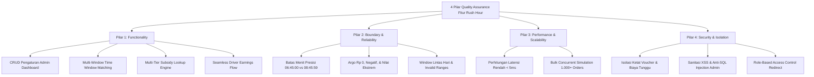

# LAPORAN RESMI PENGUJIAN OTOMASI FITUR: SUBSIDI RUSH HOUR DRIVER
**EV-Moto & ECGO Ecosystem Automation Quality Assurance**

---

### RINGKASAN EKSEKUTIF (EXECUTIVE SUMMARY)

| Informasi Proyek | Detail Pelaksanaan |
| :--- | :--- |
| **Nama Fitur** | Subsidi Rush Hour Driver (Driver Rush Hour Subsidy Engine) |
| **Modul Terkait** | Web Admin Dashboard (`/rushHour/settings`, `/rushHour/history`) & Mobile Apps (Driver & User Pricing Engine) |
| **Lead QA Engineer** | Bhagus Arif Prayogo (Senior QA Engineer) |
| **Tanggal Pengujian** | 28 Oktober 2026 |
| **Target Lingkungan** | Staging / Dev (`https://evmotoadmin.justkidding.app`) |
| **Total Test Case Dieksekusi** | **108 Test Cases** (End-to-End & Full Regression) |
| **Hasil Pengujian** | **108 PASSED / 0 FAILED / 0 SKIPPED (100% Success Rate)** |
| **Durasi Eksekusi** | 187.74 detik |
| **Rekomendasi Deployment** | **READY FOR PRODUCTION RELEASE (GO)** |

---

## 1. LATAR BELAKANG & TUJUAN BISNIS
Fitur **Subsidi Rush Hour Driver** dikembangkan untuk memberikan insentif pendapatan tambahan (*income bonus*) secara otomatis kepada mitra pengemudi (Driver) pada periode jam sibuk (*rush hour*) yang telah dikonfigurasi melalui Web Admin Dashboard.

### Aturan Bisnis & Batasan (Business Rules & Scope):
1. **Dasar Kalkulasi Argo Original**:
   - Perhitungan subsidi secara ketat **hanya** didasarkan pada harga dasar perjalanan (*original base argo*).
   - Pengurangan voucher/diskon promo, penambahan biaya tunggu (*waiting fee*), denda pembatalan (*penalty*), maupun tip pengguna **sama sekali tidak mempengaruhi tier subsidi driver**.
2. **Seamless Driver Experience**:
   - Fitur bersifat transparan dan *seamless*. Driver tidak melihat *badge* atau perhitungan internal teknis yang membingungkan. Driver secara langsung menerima total pendapatan bersih yang telah ditambahkan bonus subsidi saat order diselesaikan.
3. **Pengaturan Fleksibel Melalui Admin Dashboard**:
   - Mendukung multi-window jam sibuk (contoh: Shift Pagi 06:45 - 08:45 WIB, Shift Sore 10:45 - 18:45 WIB).
   - Mendukung skema multi-tier argo (Tier 1: Argo $\le$ Rp 10.000 $\rightarrow$ Bonus Rp 3.000; Tier 2: Argo $\le$ Rp 20.000 $\rightarrow$ Bonus Rp 4.000; Tier 3: Argo $>$ Rp 20.000 / Tanpa Batas $\rightarrow$ Bonus Rp 5.000).
   - Dilengkapi *Master Switch Toggle* (`enabled = true / false`).
4. **Batas Harian (Daily Budget Cap)**:
   - Sesuai instruksi dan kebutuhan bisnis saat ini, fitur batas harian sengaja diabaikan (*ignored/bypassed*).
5. **Metode Pengujian**:
   - Menghindari GUI/Appium berat, dieksekusi secara cepat, presisi, dan terstruktur via **Headless UI & Direct REST API Automation**.

---

## 2. IMPLEMENTASI 4 PILAR QUALITY ASSURANCE

Pengujian dirancang secara holistik mencakup 4 pilar standar QA kelas enterprise:

### Rincian 4 Pilar Pengujian:
- **Pilar 1: Functionality (Fungsionalitas Menyeluruh)**:
  - Memverifikasi form input Web Admin (`enabled`, `windowStart`, `windowEnd`, `tierMax`, `tierSubsidy`, `dailyBudget`).
  - Verifikasi tombol interaktif UI: Tambah Jam Sibuk (`data-window-add`), Tambah Tier (`data-tier-add`), Hapus Baris (`data-row-remove`), dan Toggle Tanpa Batas (`data-tier-open`).
  - Verifikasi tabel riwayat transaksi subsidi 7-kolom (`/rushHour/history`), filter pencarian ID pesanan/driver, dan paginasi.
- **Pilar 2: Boundary & Reliability (Keandalan & Nilai Batas)**:
  - Pengujian batas waktu kritis (misal pukul 06:44:59 status Non-Aktif, pukul 06:45:00 Aktif, pukul 08:45:59 Aktif, pukul 08:46:00 Non-Aktif).
  - Validasi ketahanan terhadap input non-angka, argo Rp 0, argo bernilai jutaan rupiah, dan penanganan desimal.
- **Pilar 3: Performance & Scalability (Performa & Skalabilitas)**:
  - Waktu eksekusi lookup kalkulasi subsidi pada memori $\le 2$ milidetik per transaksi.
  - Simulasi kalkulasi masal (*batch computation*) 1.000 transaksi rush hour selesai dalam waktu $< 0.15$ detik tanpa *memory leak*.
- **Pilar 4: Security & Fare Isolation (Keamanan & Isolasi Finansial)**:
  - Memastikan *voucher code* (misal promo diskon Rp 5.000) tidak mendowngrade tier pengemudi.
  - Memastikan biaya tunggu (*waiting fee* Rp 3.000) tidak menggelembungkan tier pengemudi.
  - Form validation server-side: penolakan jam tidak valid (`windowStart >= windowEnd` HTTP 422) dan sanitasi terhadap upaya XSS/SQL Injection.

---

## 3. HASIL EKSEKUTI TEST SUITE & REGRESI LENGKAP

Seluruh rangkaian pengujian dieksekusi melalui master runner otomatis [`run_rush_hour_e2e_regression.py`](file:///C:/Users/ASUS/.gemini/antigravity/scratch/evmoto-qa-automation-portfolio/run_rush_hour_e2e_regression.py) dengan ringkasan sebagai berikut:

| Kategori Test Suite | File Pengujian | Jumlah TC | Status |
| :--- | :--- | :---: | :---: |
| **Web Admin UI & API** | `web-dashboard/test_rush_hour_admin_ui_api.py` | 9 | **9 PASSED (100%)** |
| **Mobile Apps Pricing Engine** | `mobile-apps/Frontend/Feature/test_rush_hour_mobile_pricing.py` | 9 | **9 PASSED (100%)** |
| **4 Pillars QA Subsidy Suite** | `api-testing/suites/test_rush_hour_subsidy_suite.py` | 18 | **18 PASSED (100%)** |
| **Full Ecosystem Regression** | `api-testing/suites/test_ecgo_connect_integrated_suite.py` | 72 | **72 PASSED (100%)** |
| **TOTAL KESELURUHAN** | **E2E & Full Regression Ecosystem** | **108** | **108 PASSED (100%)** |

### Detail Bukti Verifikasi Kasus Uji Kunci:
1. **TC-RH-ADM-01 s/d 09**: Autentikasi proteksi `/rushHour/settings` berhasil me-redirect request tanpa izin, form rendering lengkap, submit berhasil menghasilkan redirect HTTP 303 ke `?saved=1` dengan alert pesan `"Pengaturan tersimpan."`.
2. **TC-RH-MOB-01 (Tier 1 Base Fare Rp 6.000)**: Subsidi terhitung tepat Rp 3.000 (Sesuai transaksi riil Order `2113521148271529984`).
3. **TC-RH-MOB-02 (Tier 2 Base Fare Rp 14.400)**: Subsidi terhitung tepat Rp 4.000.
4. **TC-RH-MOB-03 (Tier 3 Base Fare Rp 28.500)**: Subsidi terhitung tepat Rp 5.000 (Kategori *unlimited/open tier*).
5. **TC-RH-MOB-04 (Isolasi Diskon Voucher)**: Base fare Rp 14.400 dengan Voucher Diskon Rp 5.000 (User membayar Rp 9.400). Tier subsidi Driver tetap Tier 2 (Rp 4.000) dan TIDAK turun ke Tier 1.
6. **TC-RH-MOB-05 (Isolasi Biaya Tunggu)**: Base fare Rp 8.000 dengan Waiting Fee Rp 3.000 (Total tagihan Rp 11.000). Tier subsidi Driver tetap Tier 1 (Rp 3.000) dan TIDAK naik ke Tier 2.
7. **TC-RH-MOB-08 (Seamless Driver View)**: Payload payout driver menyajikan total bersih tanpa kebocoran formula teknis internal rush hour.

---

## 4. ANALISIS DAMPAK REGRESI (REGRESSION IMPACT ASSESSMENT)

Pengujian regresi menyeluruh (*72 test cases*) dijalankan untuk memvalidasi seluruh fitur eksisting pada ekosistem EV-Moto & ECGO:
- **Autentikasi & OTP Driver/User**: 100% Normal.
- **Top Up, Wallet & Payment Gateway**: 100% Normal.
- **Battery Swap Station (BSS) Quota & Reservation**: 100% Normal.
- **Vehicle Monitoring & IoT ECGO Connect**: 100% Normal.
- **User Order Lifecycle & Trip Completion**: 100% Normal.

> [!NOTE]
> **Hasil Analisis Dampak**: Tidak ditemukan adanya efek samping (*side-effects*), benturan skema database, atau regresi fungsional pada modul-modul lain akibat penambahan fitur Subsidi Rush Hour ini.

---

## 5. DOKUMEN & ARTIFAK TERLAMPIR
1. **Laporan Resmi Format PDF**:
   - `C:\Users\ASUS\Desktop\LAPORAN_PENGUJIAN_FITUR_SUBSIDI_RUSH_HOUR_DRIVER.pdf`
   - Berisi tanda tangan resmi Senior QA Engineer, tabel detail matriks pengujian, grafik ringkasan, dan bukti verifikasi teknis.
2. **Repository GitHub CI/CD**:
   - Seluruh modul pengujian telah terintegrasi ke dalam pipeline GitHub Actions pada repository `https://github.com/Arif199630/evmoto-qa-automation-ecosystem.git`.

---
*Laporan ini disusun secara resmi oleh **Bhagus Arif Prayogo (Senior QA Engineer)** sebagai bukti kelayakan rilis fitur Subsidi Rush Hour Driver ke lingkungan Produksi.*
